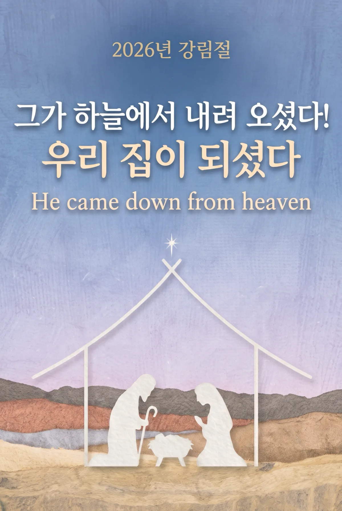
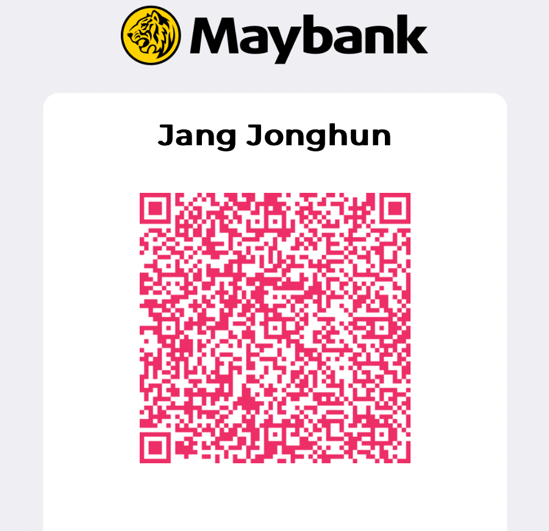

## 🕯️ 강림절(降臨節)

1. **기간**: 예수 그리스도의 탄생을 기다리는 절기, 4주간
2. **제1주**: 소망의 촛불(보라색), 메시야의 오심을 소망함
3. **미리 크리스마스 (연합)**: 12월 6일(주일) 오전 11시 📅 [캘린더에 추가](https://calendar.google.com/calendar/render?action=TEMPLATE&text=%EB%AF%B8%EB%A6%AC%20%ED%81%AC%EB%A6%AC%EC%8A%A4%EB%A7%88%EC%8A%A4%20%28%EC%97%B0%ED%95%A9%29&dates=20261206T110000/20261206T123000&details=%ED%8E%98%EB%82%AD%ED%95%9C%EC%9D%B8%EA%B5%90%ED%9A%8C%20%EB%AF%B8%EB%A6%AC%20%ED%81%AC%EB%A6%AC%EC%8A%A4%EB%A7%88%EC%8A%A4%20%EC%97%B0%ED%95%A9%20%EC%98%88%EB%B0%B0&location=598-01-02%2C%20Menara%20Asas%2C%20Tanjung%20Bungah%2C%2011200%2C%20Penang%2C%20Malaysia&ctz=Asia/Kuala_Lumpur)
4. **성탄절 예배 및 성찬식**: 12월 25일(금) 📅 [캘린더에 추가](https://calendar.google.com/calendar/render?action=TEMPLATE&text=%EC%84%B1%ED%83%84%EC%A0%88%20%EC%98%88%EB%B0%B0%20%EB%B0%8F%20%EC%84%B1%EC%B0%AC%EC%8B%9D&dates=20261225T110000/20261225T123000&details=%ED%8E%98%EB%82%AD%ED%95%9C%EC%9D%B8%EA%B5%90%ED%9A%8C%20%EC%84%B1%ED%83%84%EC%A0%88%20%EC%98%88%EB%B0%B0%20%EB%B0%8F%20%EC%84%B1%EC%B0%AC%EC%8B%9D&location=598-01-02%2C%20Menara%20Asas%2C%20Tanjung%20Bungah%2C%2011200%2C%20Penang%2C%20Malaysia&ctz=Asia/Kuala_Lumpur)

  

---

## 📋 2026년 하반기 임원회

- **일시**: 예배 후 오후 1시 📅 [캘린더에 추가](https://calendar.google.com/calendar/render?action=TEMPLATE&text=2026%EB%85%84%20%ED%95%98%EB%B0%98%EA%B8%B0%20%EC%9E%84%EC%9B%90%ED%9A%8C&dates=20261129T130000/20261129T143000&details=%ED%8E%98%EB%82%AD%ED%95%9C%EC%9D%B8%EA%B5%90%ED%9A%8C%202026%EB%85%84%20%ED%95%98%EB%B0%98%EA%B8%B0%20%EC%9E%84%EC%9B%90%ED%9A%8C%20-%20%EC%A7%91%EC%82%AC%20%EC%9D%B4%EC%83%81%2C%20%ED%95%98%EB%B0%98%EA%B8%B0%20%ED%96%89%EC%82%AC%20%EB%B0%8F%20%EC%9E%AC%EC%A0%95%EB%B3%B4%EA%B3%A0%2C%20%EA%B5%90%EC%9C%A1%EA%B4%80&location=598-01-02%2C%20Menara%20Asas%2C%20Tanjung%20Bungah%2C%2011200%2C%20Penang%2C%20Malaysia&ctz=Asia/Kuala_Lumpur)
- **장소**: 교육관
- **대상**: 집사 이상
- **안건**: 하반기 행사 및 재정보고

---

## 📋 12월 기획위원회

- **일시**: 12월 6일(주일) 예배 후 📅 [캘린더에 추가](https://calendar.google.com/calendar/render?action=TEMPLATE&text=12%EC%9B%94%20%EA%B8%B0%ED%9A%8D%EC%9C%84%EC%9B%90%ED%9A%8C&dates=20261206T133000/20261206T150000&details=%ED%8E%98%EB%82%AD%ED%95%9C%EC%9D%B8%EA%B5%90%ED%9A%8C%2012%EC%9B%94%20%EA%B8%B0%ED%9A%8D%EC%9C%84%EC%9B%90%ED%9A%8C%20-%20%EC%98%88%EB%B0%B0%20%ED%9B%84&location=598-01-02%2C%20Menara%20Asas%2C%20Tanjung%20Bungah%2C%2011200%2C%20Penang%2C%20Malaysia&ctz=Asia/Kuala_Lumpur)

---

## 💼 [2027년도 1인 1사역 지원]({{ '/news/2026/10/25/ministry-recruitment-2027/' | relative_url }})

- **신청**: 홈페이지 소식 & 공지의 [모집 안내 및 구글 신청서]({{ '/news/2026/10/25/ministry-recruitment-2027/' | relative_url }})

---

## 🎄 어린이부 성탄절 기념 달란트 시장

- **감사**: 물품을 후원해 주신 분들께 감사드립니다
- **안내**: 예배 후 달란트 물품을 구입하실 수 있습니다 (수익은 어린이부 재정으로 사용)

---

## 🙌 섬김 안내

### 식사 섬김

- 여선교회
- 소망속

---

## 🏠 심방

- **대상**: 개인, 가정, 직장, 사업장
- **문의**: 한유림 사모 (카카오톡 navinyou, 016-550-2423)

---

## 💳 마음을 드리는 예물 안내

온라인으로도 정성을 담아 예배에 참여하실 수 있습니다.

### 온라인 헌금 계좌

<strong>MAYBANK</strong> 5071 6167 5233 
<strong>예금주</strong> Jang Jong Hun (재정부장)

송금 시 <strong>성함 + 코드</strong> 입력 &nbsp;
<strong>A</strong> 십일조 · <strong>B</strong> 감사 · <strong>C</strong> 주일 · <strong>D</strong> 선교 · <strong>E</strong> 건축 · <strong>F</strong> 절기 · <strong>G</strong> 특별/목적 · <strong>H</strong> 간식 · <strong>I</strong> 부흥회 
예) Hong Gildong A → 십일조

  
  
은행 앱에서 스캔하여 송금하실 수 있습니다

---

## 🚗 주차 안내

**유니클로 주차장**을 이용해 주시기 바랍니다.

---

## 🤝 협력 및 후원

### 부설기관
- 페낭우리도서관

### 선교후원
- 생명나무
- 성경 번역

---
